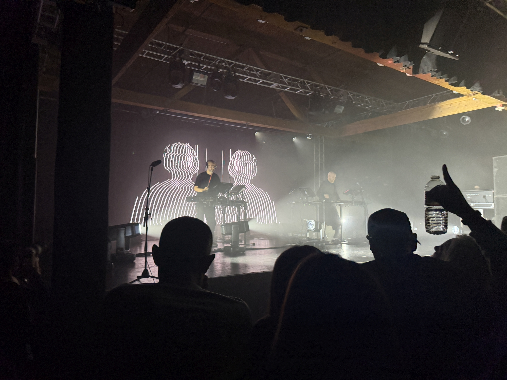
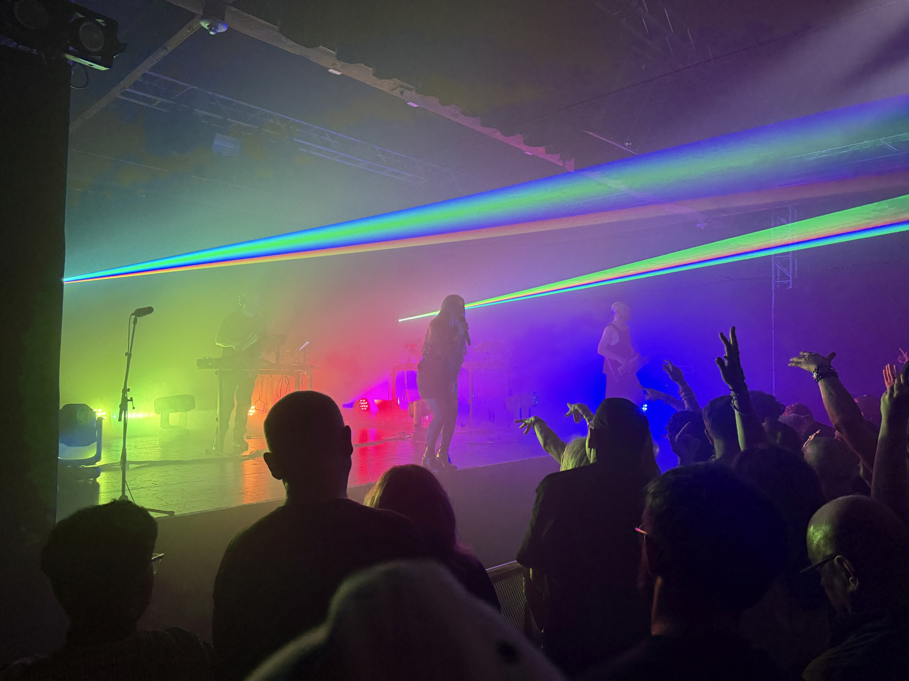

after learning about the event randomly through the underscores and ninajirachi concert at gas works park back in august (okay technically it was skrillex's event but i was mainly there for underscores, ninajirachi, and porter robinson), i decided last-minute to buy a ticket to the tinlicker with helsloot show at showbox sodo, and i think it's one of the best shows i've ever been to. i admittedly wasn't super familiar with their music prior to going, but the track that put them on my map was [rebirth (feat. hero baldwin)](https://youtu.be/7XdFH_Jdl3w)

hearing that track live was an insanely surreal moment to me, and the emotional messaging of the song just hit even harder in that setting. just before the song, hero shouted people should get to love whoever they want, which was met with roars and cheers from the crowd. and the pride lights going on during the song were just a cherry on top. easily my favorite bit of the night. i try not to take photos during events, but i just had to snap a pic:

because i decided to go so last-minute (literally the day before the event), and mostly because i've been spending way too much this month, i opted not to buy a second ticket for a friend like i normally would do, just because i'm someone who likes to go dancing with other people. so i opted to go by myself this time, and i had a surprisingly good time. instead of having to also worry about my friend's sim statuses (ya know, like when a sim is green for good, orange/yellow/red if they need something depending on the severity of the need), all i had to do was worry about my own and enjoy the music, which helped me feel a lot more present in the moment and the music

yet, surprisingly, going alone didn't feel *lonely*, i actually felt connected to the ravers around me, which i admit is a kind of rare feeling for me. i met a couple who complimented my crystal earrings and told me they'd been going to tinlicker's shows since 2018. there was another raver besides me who knew every lyric to the songs that had them, and we kinda vibed with each other. when an opening appeared in the crowd in front of me, a lady encouraged me forward. the togetherness was overwhelmingly wonderful. i'm not sure how much i would've appreciated it if i took a friend with me

this isn't to say i'm never going dancing with friends again, i love and still prefer dancing with friends. but i think this experience opened my eyes to how much fun it can be to dance alone

